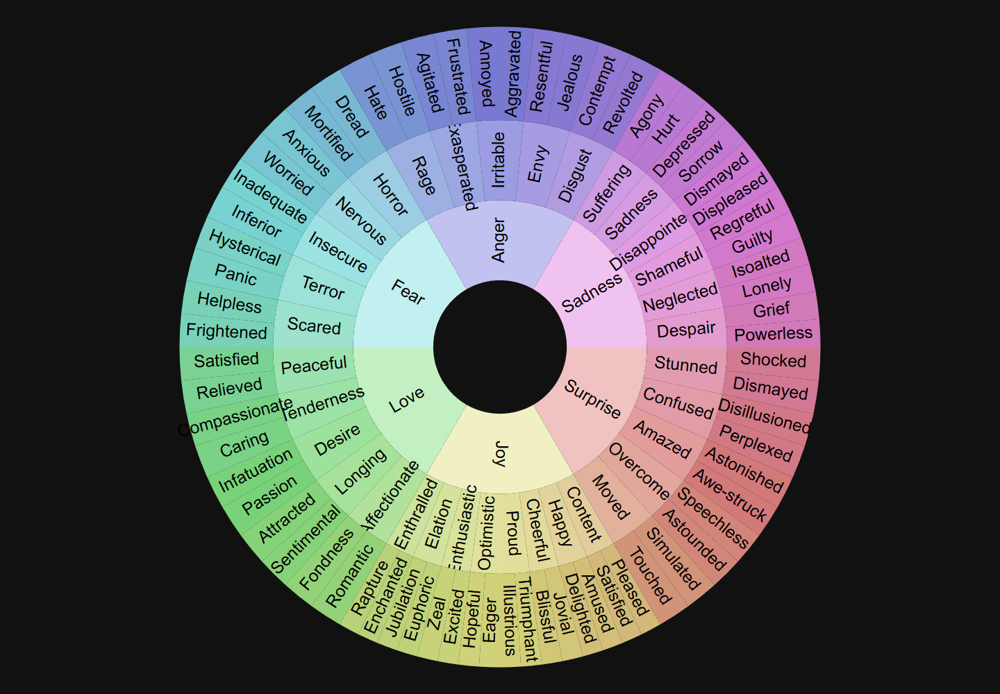

# Emotional Wheel

A small, dependency-free SVG emotion wheel built with vanilla HTML, CSS, and JavaScript.

**[Open the live wheel](https://nastajus.github.io/emotion-wheel/)**



This project began as an exploration of how emotion vocabularies can be represented as interchangeable, hierarchical data rather than as a single fixed graphic. The current dataset and visual structure are based primarily on the [Junto Emotion Wheel](https://www.thejuntoinstitute.com/2024/08/28/emotion-wheels/): six broad emotion families lead to related terms and then to more precise words.

## Why the Junto wheel?

The choice is partly personal. The Junto wheel resonates with me more than Plutchik's Wheel of Emotions or Gloria Willcox's Feeling Wheel. Its prominent Joy and Love families and large vocabulary, together with this prototype's pastel presentation, make it feel more positive and give me more specific words to choose from. That is a preference, not a claim that Junto is the most scientifically supported model.

The systems have different aims:

- **Junto** is presented as a practical tool for naming feelings, self-awareness, and conversations. Its nested vocabulary encourages movement from a broad state such as Joy or Fear toward a more precise word.
- **Plutchik** is a theoretical model with eight basic emotions, opposing pairs, intensity levels, and combinations called dyads. Its familiar flower and three-dimensional cone encode relationships that are more complex than a hierarchy of concentric pie slices.
- **Willcox** created the Feeling Wheel as a therapeutic aid for recognizing and communicating feelings. Her 1982 article explicitly balances pleasant and unpleasant primary feelings and provides space for people to add their own words.

This project should therefore be understood as an interface and data-visualization experiment, not a diagnostic or validated psychological instrument.

## Current features

- Renders a three-level emotion hierarchy as concentric SVG wedges.
- Includes 108 labels across six top-level Junto-derived families: Surprise, Joy, Love, Fear, Anger, and Sadness.
- Generates an evenly spaced palette when top-level hues are omitted.
- Supports numeric `baseHue` overrides for top-level nodes and outer leaf nodes.
- Blends middle-ring hues toward neighboring top-level families around the color circle.
- Darkens and desaturates colors toward the outer rings.
- Rotates labels around the wheel while keeping text upright on the left side.
- Sizes the SVG view box from the wheel dimensions so the full wheel remains visible.
- Supports cursor-centered mouse-wheel zoom and click-drag or touch panning across the wheel's full bounds.
- Recalculates navigation bounds from the available viewport, keeping the wheel reachable when the surrounding layout changes size.
- Distinguishes a stationary click from a drag: click a word to select it and open its popup; drag to pan.
- Highlights the selected wedge and cycles through adjacent words on the same ring when scrolling over the popup.
- Expands English and selected-language definitions independently, so either or both can be visible.
- Bundles all definitions with the project for instant lookup without network requests.
- Switches instantly between English, Spanish, French, German, Lithuanian, Japanese, Simplified Chinese, Russian, Persian, and Vietnamese.
- Cycles languages by scrolling over the selector without clicking, with continuous first-to-last looping.
- Filters the scrolling language set with per-language checkmarks plus Check all and Check none controls.
- Keeps the canonical English term visible in translated popups and supports shareable `?lang=` URLs.
- Fits translated labels to their wedges and handles Persian right-to-left text.
- Collapses the language sidebar from its always-visible edge handle.
- Prints the wheel by itself on one landscape Letter page.
- Can switch between the Junto-derived data and a smaller test tree in the source.

## Running locally

On Windows, double-click `launch.cmd`, or run either launcher from a terminal:

```powershell
.\launch.ps1
```

```cmd
launch.cmd
```

The launcher selects an available local port, serves the project with Python's standard HTTP server, and opens the default browser. A specific port can also be supplied:

```powershell
.\launch.ps1 -Port 8080
```

The project can also be served manually:

```powershell
py -m http.server 8000
```

Then open <http://127.0.0.1:8000/>.

Serving the files is preferable to opening `index.html` directly because the emotion data is loaded as a JavaScript module.

## Data and customization

The active hierarchy is defined in [`emotionTreeDataJunto.js`](emotionTreeDataJunto.js). Each node has a canonical English `name` and may contain `children`:

```js
{
  name: "Joy",
  baseHue: 60,
  children: [
    {
      name: "Content",
      children: [
        { name: "Pleased" },
        { name: "Satisfied" }
      ]
    }
  ]
}
```

If a top-level `baseHue` is not supplied, the renderer assigns one by distributing the top-level nodes evenly around the HSL color circle. The current implementation accepts hue values rather than arbitrary CSS fill colors. Leaf nodes may also provide `baseHue`; explicit middle-level hues are not currently used by the active color calculation.

The renderer was designed with interchangeable trees in mind, but it is not yet a general-purpose hierarchy visualizer. The active version assumes exactly three displayed levels and gives siblings equal angular width. A separate refactor branch explores recursive layout and configuration, but remains unfinished.

Translations are bundled in [`translations.js`](translations.js), and the definition catalog is bundled in [`definitions.js`](definitions.js), so switching languages and opening definitions work without runtime network requests. They were developed from machine-assisted drafts with context-specific corrections for ambiguous emotion words. They have not been professionally reviewed in every language; corrections and culturally better equivalents are welcome.

## Scope and possible directions

The concentric pie model works naturally for Junto- and Willcox-like taxonomies. Plutchik's model is structurally different: its petal geometry, opposing emotions, intensity axis, dyads, and optional three-dimensional cone carry meaning that would be lost if they were forced into ordinary nested rings. Supporting it properly would require a second layout model rather than another data file. After exploring that representation, I chose to keep the prototype focused instead of implementing a complex model I did not yet understand well enough to represent faithfully.

Other directions considered during development include:

- **Definitions and word exploration.** Each emotion has a concise, context-specific English definition and a bundled definition in every supported language. English and the selected language can be expanded independently for side-by-side comparison. Richer usage notes and professionally reviewed definitions remain possible future work.
- **Deeper localization.** Emotion labels are translated, while the surrounding interface and explanatory text remain in English for now.
- **Translation fidelity.** Emotion vocabularies do not map one-to-one across languages. Multiple English terms may collapse into one translated word, one term may require a phrase, or a target language may divide the concept differently. Treating those mismatches as data rather than hiding them would make this an interesting language and interface project.
- **Additional wheel families.** A pluggable renderer could select a concentric hierarchy, a Plutchik-style radial model, or another layout according to the semantics of the source system.

## Notes on the references

The three main references should not be ranked on a single informal "scientific" scale. They differ in purpose and provenance:

1. The Junto Institute describes its wheel as a tool for labeling feelings, self-awareness, empathy, and individual or group check-ins. Its value here is its usable vocabulary and organization, not a claim that it is a formal theory of emotion.
2. Plutchik's model represents eight basic emotions, three intensity levels, opposing pairs, and compound dyads. Its geometry is part of the model rather than merely decoration.
3. Willcox's original Feeling Wheel was published as a practical therapeutic tool for expanding emotional vocabulary and communication. It uses six primary feelings, related outer terms, and blank spaces for personal additions.
4. Cross-language emotion terms require caution. Research comparing English and Polish basic-emotion lexicons found that more than 80% of terms achieved only partial translation equivalence, illustrating why a multilingual wheel cannot safely rely on simple one-word substitution.

## Sources

- [The Junto Emotion Wheel](https://www.thejuntoinstitute.com/2024/08/28/emotion-wheels/), The Junto Institute.
- [The Feeling Wheel: A Tool for Expanding Awareness of Emotions and Increasing Spontaneity and Intimacy](https://thefeelingswheel.com/wp-content/uploads/2024/09/willcox1982_feelingswheel.pdf), Gloria Willcox, *Transactional Analysis Journal*, 1982.
- [PyPlutchik: Visualising and comparing emotion-annotated corpora](https://doi.org/10.1371/journal.pone.0256503), Semeraro et al., *PLOS ONE*, 2021.
- [Issues in the translation equivalence of basic emotion terms](https://doi.org/10.1016/j.amper.2023.100128), Wierzba et al., *Ampersand*, 2023.

## Project status

This is an exploratory prototype. It has no build step or runtime dependencies, but it also has no automated test suite and retains a few prototype-era assumptions in its rendering and interaction code.
